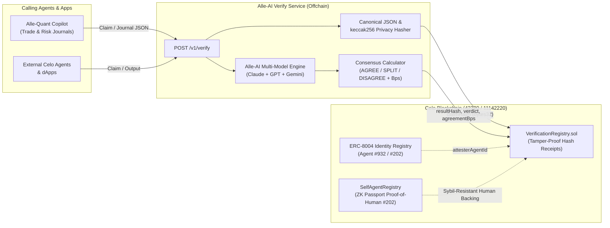

# Alle-AI Verify on Celo

**Open Multi-Model AI Output Verification & Consensus Attestation Infrastructure for the Celo Agent Economy**  
Built by **Alle-AI LTD** ([alle-ai.com](https://alle-ai.com)) · Licensed under **MIT**

---

## 1. What & Why

When autonomous AI agents execute trades, summarize research, or call external APIs, downstream agents and users face two critical trust problems:
1. **Single-Model Hallucination & Bias:** Did a single LLM hallucinate or misinterpret a critical constraint?
2. **Post-Hoc Tampering:** Was the agent's decision log or output altered after the fact?

**Alle-AI Verify** turns Alle-AI's core multi-model comparison engine (serving 35,000+ users and 30,000+ API installs) into open verification infrastructure anchored on **Celo**:
- Any agent, developer, or application calls `POST /v1/verify` with a claim, output, or structured decision rationale (such as an **Alle-Quant** autonomous trade journal entry).
- **Alle-AI Verify** evaluates the payload across multiple independent frontier models (Claude, GPT, Gemini), calculates consensus in basis points (`0–10000`, where `10000 = 100.00%`), and assigns a canonical verdict (`AGREE`, `SPLIT`, or `DISAGREE`).
- **Privacy by Design (Hashes Only):** Raw prompts, proprietary strategies, user data, and model outputs **never** touch the blockchain. Only deterministic `keccak256` hashes (`claimHash` and `resultHash`), consensus scores, model count, and the attester's ERC-8004 / Self Agent ID are anchored in the [`VerificationRegistry.sol`](./contracts/VerificationRegistry.sol) smart contract on Celo.

---

## 2. Live Onchain Deployments & Agent Identity

### Celo Mainnet (Chain ID: `42220`)
| Component | Address / ID | Verification Proof |
| :--- | :--- | :--- |
| **Self Agent ID (ERC-8004 + ZK Proof-of-Human)** | **Agent ID `#202`** | [Celoscan Mint Tx `0x2ec593a6...`](https://celoscan.io/tx/0x2ec593a6fecef15ecfedf9f85a8dea6c7c21ba9f9cbfa7a981e24407469a8ca9) · [Soulbound NFT `#202`](https://celoscan.io/nft/0xaC3DF9ABf80d0F5c020C06B04Cced27763355944/202) |
| **Live ERC-8004 / Self Agent Card** | `eip155:42220:0xaC3DF9ABf80d0F5c020C06B04Cced27763355944` (`#202`) | [`https://agent-api.self.xyz/api/cards/42220/202`](https://agent-api.self.xyz/api/cards/42220/202) |
| **Agent Owner Wallet** | `0x0339DCD1Af5c464Ff25195f015Ee0DCA161eB74A` | [View on Celoscan](https://celoscan.io/address/0x0339DCD1Af5c464Ff25195f015Ee0DCA161eB74A) |
| **Self Agent Signing Address** | `0x0Fa2A0B64Ea66Fe8153bAf1D88C3480aab55174D` | `isVerifiedAgent = true`, `isProofFresh = true` (Passport NFC ZK Proof) |

### Celo Sepolia Testnet (Chain ID: `11142220`)
| Component | Address / ID | Verification Proof |
| :--- | :--- | :--- |
| **`VerificationRegistry` Smart Contract** | `0x31c2f9f8527e556d25ac6fd40d760c147c4a0e16` | [Verified Source (`exact_match`) on Blockscout](https://celo-sepolia.blockscout.com/address/0x31c2f9f8527e556d25ac6fd40d760c147c4a0e16) · [Sepolia Celoscan](https://sepolia.celoscan.io/address/0x31c2f9f8527e556d25ac6fd40d760c147c4a0e16) |
| **Canonical ERC-8004 Identity** | **Agent ID `#932`** (`0x8004A818BFB912233c491871b3d84c89A494BD9e`) | [Registration Tx `0x84c025e2...`](https://celo-sepolia.blockscout.com/tx/0x84c025e2c870d06d066c249d86679f3ed48142f6c4074ce07a3174ebf29006fb) · [Content-Addressed URI Tx `0x99bdec72...`](https://celo-sepolia.blockscout.com/tx/0x99bdec72223b5fe099c2c76ff870eb25e3de03c4b0b879a1f47b1fd40c15dfbc) |
| **Celopedia & ERC-8021 Attribution Tag** | `alle_ai_verify` (`0x616c6c65...80218021`) | Installed in `.agents/skills/celopedia-skill` & `.claude/skills/celopedia-skill`; appended via `@celo/attribution-tags` |
| **Attestation `#0` (`AGREE`, 97.15%)** | Alle-AI Multi-Model Fact Verification | [Tx `0x03691513...`](https://celo-sepolia.blockscout.com/tx/0x036915134faffe9793659c75252c8917722e79b979091a4975c40139b4d354a6) |
| **Attestation `#1` (`AGREE`, 97.15%)** | Alle-Quant Autonomous Trade Journal & Risk Cap Audit | [Tx `0xc5d5aab1...`](https://celo-sepolia.blockscout.com/tx/0xc5d5aab1294481f883af91fb279a9fc35ecec112d0895f4ab72fae99f8d26a7b) |
| **Attestation `#2` (`SPLIT`, 30.13%)** | Multi-Agent Divergent Signal Check | [Tx `0x9041fc4c...`](https://celo-sepolia.blockscout.com/tx/0x9041fc4c2d97c8d0c15227b29e85a0fa627885f1d336f9767949da513ea326f3) |
| **Attestation `#3` (`DISAGREE`, 98.20%)** | Alle-Quant Risk Guardrail Rejection | [Tx `0x9cae91b9...`](https://celo-sepolia.blockscout.com/tx/0x9cae91b9df173ce18d266571dad1f486f6c565805e62b72a03a734081464919e) |
| **Attestation `#4` (`AGREE`, 97.15%)** | End-to-End `POST /v1/verify` Live HTTP API Call | [Tx `0xa15ad9e9...`](https://celo-sepolia.blockscout.com/tx/0xa15ad9e9f52879e35ba1458a2ae6e778df8d7fbcbd51ac8ffd2410ce43f1ce6b) |
| **Attestation `#5` (`AGREE`, 97.15%)** | Celopedia ERC-8021 Tagged Multi-Model Attestation | [Tx `0xfa124b60...`](https://celo-sepolia.blockscout.com/tx/0xfa124b60ea2e685b22a4ede37fa512a3aa7656d9299afcacc33a66daa402aa44) |

---

## 3. Architecture Diagram



---

## 4. Quick Start & How to Verify Every Claim Yourself

### Install & Run Tests
```bash
npm install
npm run compile
npm test
```

### Run Fresh Onchain Evidence Verification
Re-verifies live bytecode, Sourcify `exact_match` verification, onchain attestation counts, ERC-8004 ownership, and Celo Mainnet Self Agent ID `#202` directly from Celo RPCs:
```bash
npm run verify:evidence
# or:
bash verify_evidence.sh
```

### Start the Verification API & Public Proof Dashboard
```bash
npm start
# Open http://localhost:3001 for the Proof Page Dashboard
```

---

## 5. API Reference

### `POST /v1/verify`
Evaluates a claim or structured agent payload across multiple AI models, computes agreement in basis points (`0–10000`), and anchors a hash-only receipt on Celo.

**Request:**
```bash
curl -X POST http://localhost:3001/v1/verify \
  -H "Content-Type: application/json" \
  -d '{
    "claim": {
      "agent": "Alle-Quant",
      "symbol": "CELO/USDm",
      "side": "LONG",
      "timeframe": "4h",
      "riskCapPassed": true,
      "rationale": "Multi-model breakout confirmation with strict 1.5% position cap."
    },
    "context": { "caller": "alle-quant" },
    "models": ["claude-sonnet-4-5", "gpt-5-1", "gemini-2-5-pro"],
    "network": "sepolia",
    "anchorOnchain": true
  }'
```

**Response:**
```json
{
  "protocol": "alle-ai-verify-celo/v1",
  "claimHash": "0xa0a8a7e3df8f36c8cb12061e0f95fc373da32001f962878969c01ec2e6767164",
  "resultHash": "0x40b9e1c314d9c0b1cb665ed197f138543840a8c06a18e6a6fd089b9dde4f1d48",
  "verdict": "AGREE",
  "verdictCode": 0,
  "agreementBps": 9715,
  "agreementPct": "97.15%",
  "modelCount": 3,
  "onchain": {
    "anchored": true,
    "network": "sepolia",
    "chainId": 11142220,
    "registryAddress": "0x31c2f9f8527e556d25ac6fd40d760c147c4a0e16",
    "attestationId": 4,
    "attesterAddress": "0x0339DCD1Af5c464Ff25195f015Ee0DCA161eB74A",
    "attesterAgentId": 932,
    "txHash": "0xa15ad9e9f52879e35ba1458a2ae6e778df8d7fbcbd51ac8ffd2410ce43f1ce6b",
    "explorerUrl": "https://celo-sepolia.blockscout.com/tx/0xa15ad9e9f52879e35ba1458a2ae6e778df8d7fbcbd51ac8ffd2410ce43f1ce6b"
  }
}
```

### Other Endpoints
* `GET /v1/receipts?network=sepolia&limit=20` — Fetch recent onchain receipts directly from `VerificationRegistry`.
* `POST /v1/hash` — Compute the deterministic `keccak256` `claimHash` of any claim locally without storing data.
* `GET /agent.json` — ERC-8004 agent registration manifest.
* `GET /.well-known/agent-card.json` — A2A machine-readable agent discovery card.
* `GET /health` — Service health and Celo registry status.
